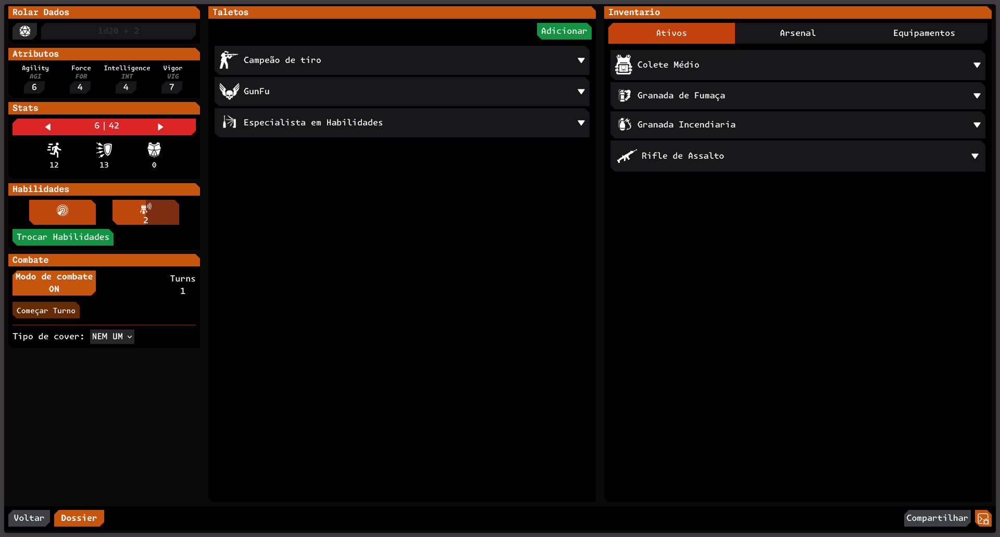
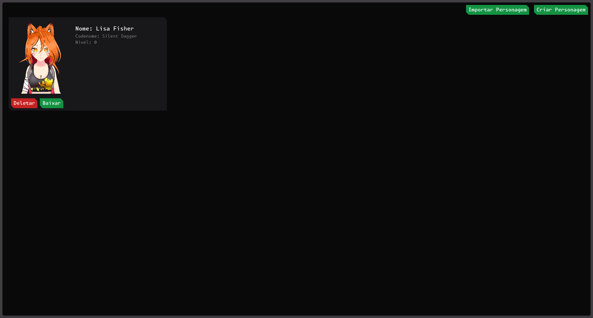

# Recon Strike

Character sheet manager for a tactical tabletop RPG (inspired by **The Division** franchase). It lets you create, import, export and play with your sheets, including a combat system, talents, skills and inventory.

## Screenshots




## Features

- **Characters**: create, import, download (JSON) and delete sheets
- **Talents & Items/Equipment**: imported from the database, with modifiers, equippable on weapons, and weapon rolls that use mods/talents
- **Skills**: database-backed skill list, upgrades, cooldown system and skill swapping
- **Combat system**: enter/leave combat mode, turns and a cover system

## Tech Stack

- [SvelteKit](https://kit.svelte.dev/) + TypeScript
- [Tailwind CSS](https://tailwindcss.com/) + [shadcn-svelte](https://www.shadcn-svelte.com/) (bits-ui)
- [Vercel](https://vercel.com/) (deployment)

## Running the project

Requirements: Node.js >= 18

```bash
# install dependencies
npm install

# start dev environment
npm run dev

# production build
npm run build

# preview the build
npm run preview
```
